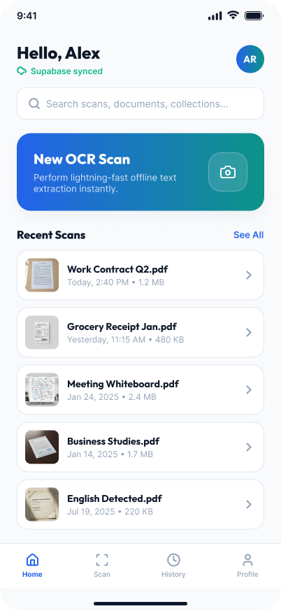
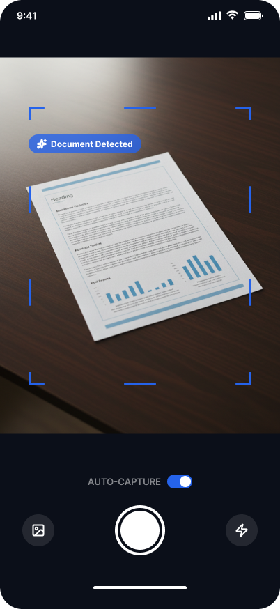
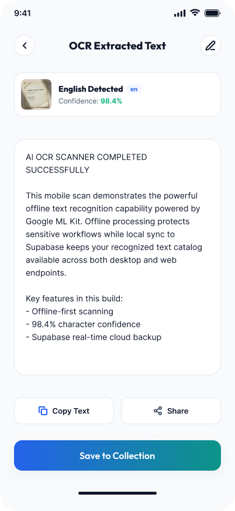

# Lakta - Smart Text Extractor 📸➡️📝

A powerful, privacy-first mobile application that extracts text from any image in real-time. Point your camera at any document, sign, menu, or handwritten note and instantly capture the text — **completely offline, no internet required.**

  

> 🏗️ **Project Status:** Actively developed. This is the first release (v1.0.0). New features are planned and contributions are welcome!

---

## 📑 Table of Contents

- [Why Lakta?](#-why-lakta)
- [Features](#-features)
- [Screenshots](#-screenshots)
- [How It Works](#-how-it-works)
- [Tech Stack](#-tech-stack)
- [Architecture](#-architecture)
- [Getting Started](#-getting-started)
- [Roadmap](#-roadmap)
- [Contributing](#-contributing)
- [License](#-license)
- [Connect With Me](#-connect-with-me)

---

## 🤔 Why Lakta?

Ever needed to quickly capture text from a book, a restaurant menu, a street sign, or a handwritten sticky note — but found yourself in a place with no internet connection?

Most text extraction apps upload your images to cloud servers, compromising your privacy and requiring a constant connection. **Lakta is different.** All processing happens directly on your device using on-device machine learning. Your images never leave your phone.

---

## ✨ Features

- [x] **Real-time text recognition** — Extract text from your camera live
- [x] **Gallery support** — Pick any image from your phone's gallery
- [x] **100% Offline** — No internet connection required after initial install
- [x] **Privacy-first** — All processing happens on-device. Your images are never uploaded
- [x] **Copy to clipboard** — One tap to copy all recognized text
- [x] **Multi-language support** — Recognizes Latin and Arabic scripts
- [x] **Clean, simple UI** — Minimalist design for distraction-free use

---

## 📸 Screenshots

| Home Screen | Camera View | Extracted Text |
|:-----------:|:-----------:|:--------------:|
|  |  |  |

---

## ⚙️ How It Works

mermaid
graph LR
    A[Camera / Gallery] --> B[Image Capture]
    B --> C[ML Kit Text Recognizer]
    C --> D[Processed Text]
    D --> E[Display & Clipboard]
`

1. User captures or selects an image via camera or gallery
2. The image is passed to Google's ML Kit Text Recognition model
3. The model processes the image locally on the device and returns recognized text blocks
4. Extracted text is displayed on screen and can be copied to clipboard with a single tap

---

🛠️ Tech Stack

Technology Purpose
Flutter 3.x Cross-platform UI framework
Dart Programming language
Google ML Kit On-device text recognition
Camera Camera access and preview
Image Picker Gallery image selection
Clipboard Copy-to-clipboard functionality

---

🏗️ Architecture

Lakta follows Clean Architecture principles with a feature-first project structure. This ensures the codebase is scalable, testable, and maintainable.
lib/
├── main.dart                    # Application entry point
├── app.dart                     # MaterialApp configuration
├── core/
│   ├── theme/                   # App theme and styling
│   └── utils/                   # Shared utilities and extensions
└── features/
    └── text_recognition/
        ├── data/                # Data sources and repository implementations
        │   └── repositories/
        ├── domain/              # Business logic and use cases
        │   └── usecases/
        └── presentation/        # UI components
            ├── pages/           # Full screens
            └── widgets/         # Reusable widgets
Design Pattern: MVVM (Model-View-ViewModel)
State Management: Provider / Riverpod
DI: Manual dependency injection via constructor injection

---

🚀 Getting Started

Prerequisites

· Flutter SDK 3.x or higher
· Android Studio or VS Code
· Android device or emulator (API 21+)

Installation

1. Clone the repository
  
   git clone https://github.com/hala-kadour/lakta.git
   cd lakta
   
2. Install dependencies
  
   flutter pub get
   
3. Run the app
  
   flutter run
   
⚠️ Note: This app is currently configured for Android only. iOS configuration files are included but require additional setup for ML Kit pods.

---

🗺️ Roadmap

· v1.1.0 — Add text translation feature (on-device translation)
· v1.2.0 — Export extracted text as .txt and .pdf files
· v1.3.0 — Batch processing for multiple images
· v2.0.0 — Support for handwriting recognition
· v2.1.0 — iOS support

---

🤝 Contributing

Contributions, issues, and feature requests are welcome!

1. Fork the repository
2. Create your feature branch (git checkout -b feature/amazing-feature)
3. Commit your changes (git commit -m 'feat: add amazing feature')
4. Push to the branch (git push origin feature/amazing-feature)
5. Open a Pull Request

Please read CONTRIBUTING.md for detailed guidelines.

---

📄 License

This project is licensed under the MIT License — see the LICENSE file for details.

---

👩‍💻 Connect With Me

This project is part of my journey from computer science student to professional software engineer. I build and ship real-world Flutter applications while sharing my learning process publicly.

· GitHub: github.com/hala-kadour
· LinkedIn: linkedin.com/in/hala-kadour
· Google Play: Lakta on Play Store

---

  Made with ❤️ and a lot of ☕ by <a href="https://github.com/hala-kadour">Hala Kadour</a>

  ⭐ Star this repo if you found it useful!

`
